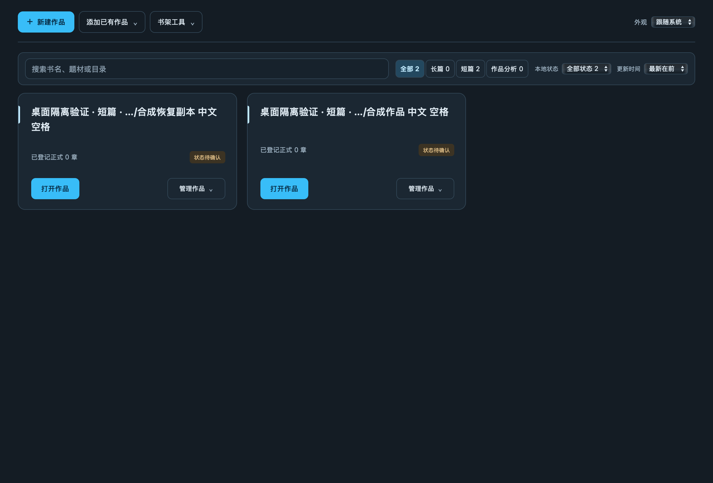

# Story Skill

**面向中文长篇与短篇小说的 AI 创作技能与本地写作工作台。**

在 AI 助手中拆书、规划、写作和改稿，在本地工作台中阅读书稿、编辑候选、比较版本和备份作品。Story Skill 把这些环节连接起来，让已有书稿、创作约定和写作进度能够在后续任务中继续使用。

支持 **Codex、Claude Code、Claude 桌面版、DeepSeek Harness、WorkBuddy AI、Qoder CN**及其他兼容 Agent Skills 的助手；另提供 **Mac / Windows 写作工作台**。

[下载安装](#安装升级) · [开始写书](#开始写书) · [工作台预览](#使用工作台) · [完整文档](docs/README.md) · [v0.6.27 发布记录](docs/releases/v0.6.27.md)

## 它能帮你做什么

| 创作阶段 | 可以交给 Story Skill 的工作 |
|---|---|
| 找方向 | 拆解参考作品，调研题材与素材，确定目标读者和故事的阅读期待 |
| 开新书 | 拟写书名、简介、人物与世界设定，建立总纲、卷纲和近期细纲 |
| 写下去 | 读取本书约定、正式断点和前文状态，衔接人物行动与伏笔，续写下一章 |
| 改书稿 | 根据原文分析平淡、因果、人物反应和文风问题，另存候选并复核修改 |
| 做交付 | 组织短篇全文、封面与投稿材料；按明确需求规划剧本或拆分镜 |
| 管作品 | 在工作台查看章节、保存候选、对照版本、搜索材料，备份和恢复整书 |

**创作技能运行在 AI 助手中，工作台负责本地书稿管理。** 正文创作通过助手进行；番茄草稿自动连接会显式启动受控 Codex 会话并使用账户额度，需要另备已登录的 Codex CLI、官方 Chrome 插件（含 SDK）及已连接的 Chrome 会话。安装桌面应用与安装助手技能分别进行。联网调研、图像生成和浏览器操作使用当前会话实际可用的工具。

## 安装升级

当前版本为 **[v0.6.27](https://github.com/NingCui29/story-skill/releases/tag/v0.6.27)**。主发行8个附件（四个包及各自 SHA256，含 DSH 插件包）与 Windows 独立发行4个附件均已正式发布。先选择要使用的部分，再按对应说明安装；两者可以配合使用。变化与完整验收范围见[发布记录](docs/releases/v0.6.27.md)。

### 安装创作技能

| 使用环境 | 下载 | 安装方式 |
|---|---|---|
| Codex 本地插件 | [插件 ZIP](https://github.com/NingCui29/story-skill/releases/download/v0.6.27/story-skill-codex-0.6.27.zip) | 解压后添加本地市场并安装插件，见 [Codex 安装说明](docs/codex-plugin.md) |
| Claude 桌面版 | [单入口 ZIP](https://github.com/NingCui29/story-skill/releases/download/v0.6.27/story-skill-claude-desktop-0.6.27.zip) | 上传并启用专用技能包，见 [桌面导入说明](INSTALL.md#claude-桌面版导入单技能包) |
| DeepSeek Harness | [DSH 插件 ZIP](https://github.com/NingCui29/story-skill/releases/download/v0.6.27/story-skill-dsh-0.6.27.zip) 或八技能目录 | `--host dsh --user` 安装到 `~/.dsh/skills/`；插件包用 `scripts/package_dsh.py` 构建，见 [DSH 安装说明](INSTALL.md#deepseek-harness) |
| WorkBuddy AI、Qoder CN | 完整八技能目录 | 源码安装器支持个人／项目目录，见 [安装与调用说明](INSTALL.md#workbuddy-ai-与-qoder-cn-快速安装) |
| Claude Code、Antigravity 等 | [完整八技能 ZIP](https://github.com/NingCui29/story-skill/releases/download/v0.6.27/story-skill-0.6.27.zip) | 保留八个同级目录，见 [目录安装说明](INSTALL.md#目录安装的完整套件) |

<a id="codex-本地插件"></a>
<a id="claude-桌面版"></a>
<a id="claude-code-与其他宿主"></a>

Codex 插件通过本地市场分发。安装后在宿主中确认技能已加载，再使用自然语言提出任务。插件和传统目录安装选择一种；迁移已有安装前，先备份并核对本地修改，避免重复加载。

源码安装器支持多个宿主及项目／个人安装范围，完整列表、命令和升级方法见 [INSTALL.md](INSTALL.md)。运行 Python 创作工具需要 **Python 3.10+**。

### 独立应用下载与安装

| 系统 | 当前客户端 | 下载 |
|---|---|---|
| Intel Mac | 0.1.37 / build 38 | [DMG](https://github.com/NingCui29/story-skill/releases/download/v0.6.25/story-workbench-0.1.37-macos-x86_64.dmg) · [ZIP](https://github.com/NingCui29/story-skill/releases/download/v0.6.25/story-workbench-0.1.37-macos-x86_64.zip) · [安装说明](desktop/macos/README.md) |
| Windows x64 | 0.2.5（C#） | [EXE 安装包](https://github.com/NingCui29/story-skill/releases/download/windows-v0.2.5/story-workbench-0.2.5-windows-x86_64-setup.exe) · [EXE SHA256](https://github.com/NingCui29/story-skill/releases/download/windows-v0.2.5/story-workbench-0.2.5-windows-x86_64-setup.exe.sha256) · [便携 ZIP](https://github.com/NingCui29/story-skill/releases/download/windows-v0.2.5/story-workbench-0.2.5-windows-x86_64.zip) · [安装说明](desktop/windows/README.md) |

**桌面应用内置 Python 作品服务，无需另装 Python。Windows 0.2.5 使用 C# / WPF / WebView2，内置 Story Skill 0.6.26，安装包内置 .NET，并按需安装随包的微软 WebView2 离线运行时。** 下载后核对同名 `.sha256` 文件。Mac 使用本地临时签名、未经 Apple 公证，Apple Silicon 尚未验证；Windows 应用安装程序未做代码签名。Windows C# 版使用独立的 [windows-v0.2.5 发行页](https://github.com/NingCui29/story-skill/releases/tag/windows-v0.2.5)，构建与验证范围见 [Windows 发布记录](docs/releases/windows-v0.2.5.md)。

**Windows 安装：** 建议使用受支持的 Windows 11 x64。下载上方 EXE 与 SHA256 文件，保存所有工作台及外部浏览器中的编辑并正常退出旧客户端，然后双击 EXE，按向导为当前用户安装，从开始菜单启动“写作工作台”。无需另装 Python 或 .NET；书稿请保存在应用目录之外。

可在安装包所在文件夹打开 PowerShell 校验，结果应与 `.sha256` 文件中的摘要一致：

```powershell
Get-FileHash .\story-workbench-0.2.4-windows-x86_64-setup.exe -Algorithm SHA256
```

从 0.2.0 或更早版本升级，请使用上述固定链接。0.2.1 起，“检查更新”读取独立 Windows 正式发行版，支持已下载包复用。安装向导会在确认全部编辑已保存后核验并正常停止相关后台服务；覆盖安装保留相邻旧目录备份，失败时尝试回退；若恢复受阻，保留备份并提示处理。

项目代码、依赖与发行包禁止使用 Qt 系列及 PHP；[技术约束与检查](docs/技术约束.md)。

升级前保存全部页面编辑并退出旧客户端。已有工作台服务按 [更新流程](docs/工作台更新流程.md)另行更新。GitHub 发版不会自动替换本机技能或应用。

[技能包与 DSH 发行文件](https://github.com/NingCui29/story-skill/releases/tag/v0.6.27) · [Windows C# 发行文件](https://github.com/NingCui29/story-skill/releases/tag/windows-v0.2.5) · [GitHub Packages 内容包](https://github.com/users/NingCui29/packages/npm/package/story-skill)（npm 安装不向宿主注册技能）。Packages 已公开发布；工作流完成实际 registry 回下载，本机独立核验工作流导出的 tarball。

## 开始写书

安装并启用技能后，可以直接向助手提出任务。把 `<…>` 换成实际需求或会话可访问的绝对路径；长篇、短篇和目标平台都可以明确指定。

### 开一本新书

```text
使用 Story Skill，帮我规划一本中文小说。
写作父目录：<绝对路径>
故事想法：<主角、处境与核心冲突>
篇幅与平台：<长篇或短篇；目标平台或待讨论>
先完成书名、简介、人物设定、全书大纲和前三章细纲，本轮不写正文。
```

### 从拆书开始

```text
使用 Story Skill，分析 <参考作品路径>，再规划一本原创新书。
先给出原文依据，提炼人物、冲突与情绪安排的方法。
新书重新设计人物、关系和事件，分析材料与原创书稿分开保存。
```

### 从市场样本找方向

v0.6.22 增加结构化研究流程：保存榜单或书库样本，核对来源和覆盖范围；在同一口径内去重、比较标签与书名特征，挑选后续阅读对象；把正文分析中的支持、反例和不足一并交给原创规划。

```text
使用 Story Skill，调研 <平台、题材与观察时间>，为 <长篇或短篇> 寻找选题方向。
先说明可见样本与缺失范围，挑选值得进一步阅读的作品并说明理由。
读取我提供或可合法获取的正文，验证写法假设，再给出原创方向、风险和下一步。
研究材料保存到 <绝对路径>，本轮不采用规划或写正文。
```

内置采集目前仅覆盖七猫公开书库的点击排序观察样本；其他来源通过联网工具或已授权浏览器记录。样本频次、抽样结果与书名相似度不能证明销量、质量或成功概率。具体范围见[扫榜与抽样](skills/story-skill-research/references/rank-scan.md)及[研究交接](skills/story-skill-research/references/research-handoff.md)。

### 写下一章

```text
使用 Story Skill，继续 <书目录绝对路径>。
先核对创作约定、正式断点、前文衔接和采用的细纲，再完成下一章。
完成审查、保存和导出核对；需要我决定的内容先保留为候选。
```

### 审稿与修改

```text
使用 Story Skill，审阅 <章节或候选稿路径>。
重点检查 <情节、人物、连续性或文风问题>，给出原文依据和修改建议。
本轮另存修改候选，暂不覆盖正式稿。
```

<a id="拟写或优化简介"></a>
<a id="剧本与分镜"></a>

也可以直接提出“优化这本书的简介”“根据小说规划剧本”或“把小说／剧本拆成分镜”。短篇完本、续写章中片段、只审不改等要求都应在任务中说明。更多示例见 [中文小说上手](docs/中文小说上手.md)与 [剧本、分镜规则](skills/story-skill-plan/references/outline.md#根据小说规划剧本)。

## 使用工作台

工作台在本机运行，提供书架和单书编辑页，把章节、策划、细纲、草稿与图片放到同一套导航中。

当前源码的界面与交互重构采用三端共享的 HTML、CSS、JavaScript 和 Python 服务，保留 Mac Swift、Windows C# 桌面宿主；实施清单、验收证据和待办见[工作台交互与视觉重构 TODO](docs/工作台交互与视觉重构TODO.md)。本地候选包与上方已公开发行版本分别记录。

快速更新开发源码新增分块校验、最多 3 路下载、暂停续传和缓存复用，Windows 另提供复用已有 WebView2 的精简更新包。目标客户端为 Mac 0.2.0 / build 40、Windows 0.3.0；实现与原生验收边界见[工作台快速更新](docs/工作台快速更新.md)，公开安装包以各端现有发行链接为准。



*截图来自 v0.6.25 / Mac 0.1.37 的隔离合成书架自检，展示两部合成作品。*

- **阅读与查找：** 按章节或文件导航，分批加载大量材料，搜索正文与材料并说明未覆盖范围，切换浅色／深色外观。
- **候选与版本：** 编辑并保存候选，查看保存状态、找回恢复稿，选择两稿比较差异；切换、重新加载和关闭时核对未保存编辑。
- **作品管理：** 新建作品、选择目录、继续上次工作、查看正在编辑的状态；重新定位、移出书架或通过系统废纸篓／回收站删除作品。
- **备份与恢复：** 整书备份、从备份恢复、查看恢复中心与操作结果。
- **继续创作：** 生成下一章写作任务，交回助手完成创作与审查。

### 通过助手或命令行打开

可以让助手“打开 `<书目录绝对路径>` 的可编辑工作台”。安装了 Python 创作工具时，也可以手动启动书架：

```bash
python3 -B -X utf8 "<核心技能目录>/scripts/story.py" workbench-library-serve --open
```

打开书架后，在“添加已有作品”中点击“选择文件夹…”并确认添加。Mac 和 Windows 客户端打开系统文件夹选择器，网页版打开工作台内的目录浏览器；选择或取消目录不会自动登记作品。“新建作品”先填写书名、选择存放位置，再核对文件夹名和完整目标路径，点击“创建并加入书架”才会创建目录。已有同名目录不会被覆盖。在工作台保存编辑会产生候选，采用为正式稿仍需走审稿与修订流程。具体操作见 [工作台说明](docs/本地工作台分析.md)与 [功能进展](docs/工作台需求与进展.md)。

## 书稿与交付

**一书一目录，书稿放在技能源码和安装目录之外。** 备份时保留整个书目录，包括 `.story/` 中的状态与候选；普通聊天或云端会话中的文件，应及时下载完整备份。

规划、候选和正式正文分别保存。长篇续写读取本书约定、正式进度、人物状态与采用细纲；短篇关注完整故事的交付。具体篇幅、附言、配图和封面要求按任务及本书约定处理，见 [章节规则](skills/story-skill-write/references/chapter.md)与 [目录规范](docs/目录结构.md)。

### 投稿材料与平台草稿

番茄、七猫、起点均可准备已审查正式章节的离线材料。当前源码的工作台同步流程为“选择范围 → 准备并检查差异 → 确认同步这些变更”，逐章区分待新建、待更新和本次检查一致。番茄检查可显式连接 Codex 工作进程与既有、已登录的 Chrome；浏览器拒绝权限时停止。修改前备份远端原稿并保留已有草稿 ID，不修改已发布章节。新保存只去除本地 MD 空白行，远端章名和正文严格比较；检查后内容变化须重新检查，未知结果先只读核对。七猫、起点沿用外部已连接助手流程。

新保存固定去掉正文的全部空白行，保留非空行的文字、标点、缩进与行末空格，其余行之间保留一次换行；本地原稿与冻结清单不改。独立回读的标题与全文须和转换后的输入逐字一致，远端额外空行或末尾换行也算差异。预览和执行使用同一规则，旧记录保留当时语义。具体规则见[正文排版与比较策略](skills/story-skill-publish/references/platform-drafts.md#正文排版与比较策略)。

面板分开显示本次同步进度、停止原因与历史核对记录，只有本次完整回读通过的章节计入完成。番茄可在预览后显式连接受控 Codex 工作进程与既有、已登录的 Chrome；浏览器拒绝权限时停止。目录按页读取并核对总数，已知读取超时最多恢复一次；创建和保存动作不重放，结果未知时先只读对账。七猫、起点沿用外部已连接助手流程。

本轮发行验证使用隔离合成材料、离线浏览器夹具和原生客户端自检，不能据此宣称真实作者作品整批同步成功，或番茄、七猫、起点的真实分页、多卷与全部页面均已验收。历史实页记录只适用于记录中的样本和当时页面。审核提交与定时发布由作者在平台后台完成。详细范围见[平台草稿说明](skills/story-skill-publish/references/platform-drafts.md)与[历史平台验收边界](docs/releases/v0.6.25.md#平台草稿的实际范围)。

## 八个技能入口

| 技能 | 用途 |
|---|---|
| `story-skill` | 总入口、任务分流与共享规则 |
| `story-skill-plan` | 书名简介、人物设定、大纲细纲、剧本规划与分镜 |
| `story-skill-write` | 正文创作、续写、长篇连载与短篇完本 |
| `story-skill-review` | 审稿、修改、排版与历史章节修订 |
| `story-skill-analyze` | 开篇点评、完整深读与分析续跑 |
| `story-skill-research` | 榜单与书库样本、代表作抽样、选题研究、试读设计与追更验证、素材与事实查证 |
| `story-skill-cover` | 封面生成、修改与规格检查 |
| `story-skill-publish` | 离线投稿材料、平台草稿保存与回读核对 |

不确定选哪个入口时，直接使用总入口描述需求。手动调用以宿主实际补全为准：Codex 插件入口如 `$story-skill:story-skill-plan`，Codex 目录安装如 `$story-skill-plan`，Claude Code 如 `/story-skill-plan`，DeepSeek Harness 如 `/story-skill-plan`（或由模型用 `skill` 工具按名称加载）；Claude 桌面包通过一个总入口读取八个流程。

## 版本与验证

**v0.6.27** 增加 DeepSeek Harness 宿主安装与本地插件包，纳入章节配图确认规则修订。Intel Mac **0.1.37 / build 38**（内置 0.6.25）与 Windows C# **0.2.5**（内置 0.6.26）继续独立分发，本次不重建桌面客户端。构建来源、分发附件及验收边界见[发布记录](docs/releases/v0.6.27.md)。

v0.6.27 的完整源码 CI、附件回下载与 GitHub Packages 同步结果以发布记录和 GitHub Actions 记录为准；本轮未重建 Windows／macOS 客户端，也未扩大平台草稿的真实页面验收范围。

**v0.6.22** 新增结构化扫榜、代表作抽样与研究交接，连接样本观察、正文验证和原创选题。修正独立研究命令在非 UTF-8 环境下的中文输出，保留原文引文的精确匹配规则。各分发包、跨平台源码 CI、固定标签安装与公开分发的实际核验范围见[发布记录](docs/releases/v0.6.22.md)；[v0.6.21 历史记录](docs/releases/v0.6.21.md)继续保留。

工程检查、宿主加载、平台实页验证与小说阅读效果分别记录。具体方法见 [评估说明](docs/evaluation.md)。

## 文档与开发

[完整文档](docs/README.md) · [安装升级](INSTALL.md) · [中文小说上手](docs/中文小说上手.md) · [作品深读](docs/作品深读与评估.md) · [备份恢复](docs/recovery.md) · [发布维护](docs/github-release.md)

`skills/` 保存技能源码，`dsh/` 为 DeepSeek Harness 插件包源码，`scripts/` 提供安装、打包和验证工具，`tests/` 为程序回归。开发检查与分发流程见 [发布维护说明](docs/github-release.md)。

## 许可与参考

当前源码采用 [自定义非商业使用／商业授权协议](LICENSE)：非商业用途免费，商业用途须另行授权并按约定付费。商业授权主体及联系字段目前仍为占位内容，具体范围与历史版本许可见 [许可说明](docs/licensing.md)。

流程设计参考 [oh-story-claudecode](https://github.com/zenstory-ai/oh-story-claudecode)，实现与取舍见 [对照说明](docs/upstream-analysis.md)。
