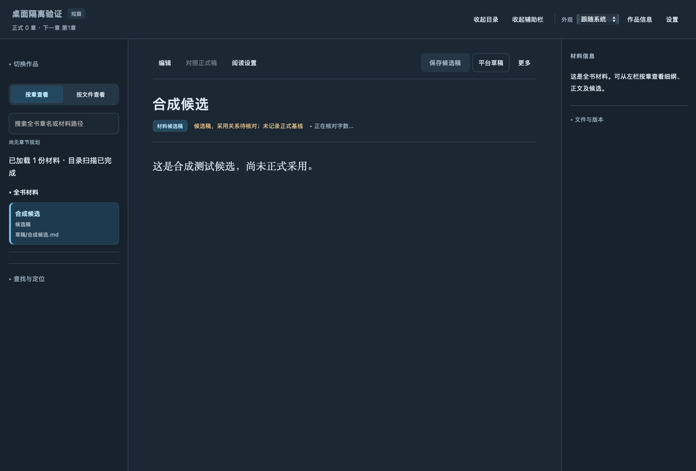

# Story Skill

> **v0.6.22 正在准备发布。** 新增结构化扫榜、代表作抽样和从正文证据到原创选题的研究交接，见[本轮记录](docs/releases/v0.6.22.md)。下方下载仍为已发布的 v0.6.21。

**面向中文长篇与短篇小说的 AI 创作技能与本地写作工作台。**

在 AI 助手中拆书、规划、写作和改稿，在本地工作台中阅读书稿、编辑候选、比较版本和备份作品。Story Skill 把这些环节连接起来，让已有书稿、创作约定和写作进度能够在后续任务中继续使用。

支持 **Codex、Claude Code、Claude 桌面版、WorkBuddy AI、Qoder CN**及其他兼容 Agent Skills 的助手；另提供 **Mac / Windows 写作工作台**。

[下载安装](#安装升级) · [开始写书](#开始写书) · [工作台预览](#使用工作台) · [完整文档](docs/README.md) · [v0.6.21 发布记录](docs/releases/v0.6.21.md)

## 它能帮你做什么

| 创作阶段 | 可以交给 Story Skill 的工作 |
|---|---|
| 找方向 | 拆解参考作品，调研题材与素材，确定目标读者和故事的阅读期待 |
| 开新书 | 拟写书名、简介、人物与世界设定，建立总纲、卷纲和近期细纲 |
| 写下去 | 读取本书约定、正式断点和前文状态，衔接人物行动与伏笔，续写下一章 |
| 改书稿 | 根据原文分析平淡、因果、人物反应和文风问题，另存候选并复核修改 |
| 做交付 | 组织短篇全文、封面与投稿材料；按明确需求规划剧本或拆分镜 |
| 管作品 | 在工作台查看章节、保存候选、对照版本、搜索材料，备份和恢复整书 |

**创作技能运行在 AI 助手中，工作台负责本地书稿管理。** 正文创作通过助手进行；番茄草稿自动连接会显式启动受控 Codex 会话并使用账户额度，需要另备已登录的 Codex CLI、官方 Chrome 插件（含 SDK）及已连接的 Chrome 会话。安装桌面应用与安装助手技能分别进行。联网调研、图像生成和浏览器操作使用当前会话实际可用的工具。

## 安装升级

当前正式版为 **[v0.6.21](https://github.com/NingCui29/story-skill/releases/tag/v0.6.21)**，下列附件已发布。先选择要使用的部分，再按对应说明安装；两者可以配合使用。变化与完整验收范围见[发布记录](docs/releases/v0.6.21.md)。

### 安装创作技能

| 使用环境 | 下载 | 安装方式 |
|---|---|---|
| Codex 本地插件 | [插件 ZIP](https://github.com/NingCui29/story-skill/releases/download/v0.6.21/story-skill-codex-0.6.21.zip) | 解压后添加本地市场并安装插件，见 [Codex 安装说明](docs/codex-plugin.md) |
| Claude 桌面版 | [单入口 ZIP（r2）](https://github.com/NingCui29/story-skill/releases/download/v0.6.21/story-skill-claude-desktop-0.6.21-r2.zip) | 上传并启用专用技能包，见 [桌面导入说明](INSTALL.md#claude-桌面版导入单技能包) |
| WorkBuddy AI、Qoder CN | 完整八技能目录 | 源码安装器支持个人／项目目录，见 [安装与调用说明](INSTALL.md#workbuddy-ai-与-qoder-cn-快速安装) |
| Claude Code、Antigravity 等 | [完整八技能 ZIP](https://github.com/NingCui29/story-skill/releases/download/v0.6.21/story-skill-0.6.21.zip) | 保留八个同级目录，见 [目录安装说明](INSTALL.md#目录安装的完整套件) |

<a id="codex-本地插件"></a>
<a id="claude-桌面版"></a>
<a id="claude-code-与其他宿主"></a>

Codex 插件通过本地市场分发。安装后在宿主中确认技能已加载，再使用自然语言提出任务。插件和传统目录安装选择一种；迁移已有安装前，先备份并核对本地修改，避免重复加载。

源码安装器支持多个宿主及项目／个人安装范围，完整列表、命令和升级方法见 [INSTALL.md](INSTALL.md)。运行 Python 创作工具需要 **Python 3.10+**。

### 独立应用下载与安装

| 系统 | 当前客户端 | 下载 |
|---|---|---|
| Intel Mac | 0.1.24 / build 25 | [DMG](https://github.com/NingCui29/story-skill/releases/download/v0.6.21/story-workbench-0.1.24-macos-x86_64.dmg) · [ZIP](https://github.com/NingCui29/story-skill/releases/download/v0.6.21/story-workbench-0.1.24-macos-x86_64.zip) · [安装说明](desktop/macos/README.md) |
| Windows x64 | 0.1.11 | [安装程序](https://github.com/NingCui29/story-skill/releases/download/v0.6.21/story-workbench-0.1.11-windows-x86_64-setup.exe) · [便携 ZIP](https://github.com/NingCui29/story-skill/releases/download/v0.6.21/story-workbench-0.1.11-windows-x86_64.zip) · [安装说明](desktop/windows/README.md) |

**桌面应用已内置 Python 和运行时，无需另装 Python。** 下载后核对 Release 中的同名 `.sha256` 文件。Mac 使用本地临时签名、未经 Apple 公证，Apple Silicon 尚未验证；Windows 安装程序未做代码签名。

升级前保存全部页面编辑并退出旧客户端。已有工作台服务按 [更新流程](docs/工作台更新流程.md)另行更新。GitHub 发版不会自动替换本机技能或应用。

[全部发行文件与校验文件](https://github.com/NingCui29/story-skill/releases/tag/v0.6.21) · [GitHub Packages 内容包](https://github.com/users/NingCui29/packages/npm/package/story-skill)（已同步并核验；npm 安装不向宿主注册技能）

## 开始写书

安装并启用技能后，可以直接向助手提出任务。把 `<…>` 换成实际需求或会话可访问的绝对路径；长篇、短篇和目标平台都可以明确指定。

### 开一本新书

```text
使用 Story Skill，帮我规划一本中文小说。
写作父目录：<绝对路径>
故事想法：<主角、处境与核心冲突>
篇幅与平台：<长篇或短篇；目标平台或待讨论>
先完成书名、简介、人物设定、全书大纲和前三章细纲，本轮不写正文。
```

### 从拆书开始

```text
使用 Story Skill，分析 <参考作品路径>，再规划一本原创新书。
先给出原文依据，提炼人物、冲突与情绪安排的方法。
新书重新设计人物、关系和事件，分析材料与原创书稿分开保存。
```

### 从市场样本找方向

v0.6.22 增加结构化研究流程：保存榜单或书库样本，核对来源和覆盖范围；在同一口径内去重、比较标签与书名特征，挑选后续阅读对象；把正文分析中的支持、反例和不足一并交给原创规划。

```text
使用 Story Skill，调研 <平台、题材与观察时间>，为 <长篇或短篇> 寻找选题方向。
先说明可见样本与缺失范围，挑选值得进一步阅读的作品并说明理由。
读取我提供或可合法获取的正文，验证写法假设，再给出原创方向、风险和下一步。
研究材料保存到 <绝对路径>，本轮不采用规划或写正文。
```

内置采集目前仅覆盖七猫公开书库的点击排序观察样本；其他来源通过联网工具或已授权浏览器记录。样本频次、抽样结果与书名相似度不能证明销量、质量或成功概率。具体范围见[扫榜与抽样](skills/story-skill-research/references/rank-scan.md)及[研究交接](skills/story-skill-research/references/research-handoff.md)。

### 写下一章

```text
使用 Story Skill，继续 <书目录绝对路径>。
先核对创作约定、正式断点、前文衔接和采用的细纲，再完成下一章。
完成审查、保存和导出核对；需要我决定的内容先保留为候选。
```

### 审稿与修改

```text
使用 Story Skill，审阅 <章节或候选稿路径>。
重点检查 <情节、人物、连续性或文风问题>，给出原文依据和修改建议。
本轮另存修改候选，暂不覆盖正式稿。
```

<a id="拟写或优化简介"></a>
<a id="剧本与分镜"></a>

也可以直接提出“优化这本书的简介”“根据小说规划剧本”或“把小说／剧本拆成分镜”。短篇完本、续写章中片段、只审不改等要求都应在任务中说明。更多示例见 [中文小说上手](docs/中文小说上手.md)与 [剧本、分镜规则](skills/story-skill-plan/references/outline.md#根据小说规划剧本)。

## 使用工作台

工作台在本机运行，提供书架和单书编辑页，把章节、策划、细纲、草稿与图片放到同一套导航中。



*截图来自 v0.6.21 Mac 客户端的隔离合成自检，展示合成候选材料。*

- **阅读与查找：** 按章节或文件导航，分批加载大量材料，搜索正文与材料并说明未覆盖范围，切换浅色／深色外观。
- **候选与版本：** 编辑并保存候选，保存全部候选，找回恢复稿，选择两稿比较差异。
- **作品管理：** 新建作品、重新定位目录、移出书架，通过系统废纸篓／回收站删除作品。
- **备份与恢复：** 整书备份、从备份恢复、查看恢复中心与操作结果。
- **继续创作：** 生成下一章写作任务，交回助手完成创作与审查。

### 通过助手或命令行打开

可以让助手“打开 `<书目录绝对路径>` 的可编辑工作台”。安装了 Python 创作工具时，也可以手动启动书架：

```bash
python3 -B -X utf8 "<核心技能目录>/scripts/story.py" workbench-library-serve --open
```

打开书架后添加作品目录。在工作台保存编辑会产生候选，采用为正式稿仍需走审稿与修订流程。具体操作见 [工作台说明](docs/本地工作台分析.md)与 [功能进展](docs/工作台需求与进展.md)。

## 书稿与交付

**一书一目录，书稿放在技能源码和安装目录之外。** 备份时保留整个书目录，包括 `.story/` 中的状态与候选；普通聊天或云端会话中的文件，应及时下载完整备份。

规划、候选和正式正文分别保存。长篇续写读取本书约定、正式进度、人物状态与采用细纲；短篇关注完整故事的交付。具体篇幅、附言、配图和封面要求按任务及本书约定处理，见 [章节规则](skills/story-skill-write/references/chapter.md)与 [目录规范](docs/目录结构.md)。

### 投稿材料与平台草稿

番茄、七猫、起点均可准备已审查正式章节的离线材料。平台草稿功能提供冻结清单、预览、受控保存、全文回读与重复执行核对。番茄可在预览后显式连接 Codex 工作进程与既有、已登录的 Chrome；浏览器拒绝权限时停止。段落编码与允许末尾换行数量变化分别选择，任何变更都需重新预览，未知结果先回读对账。七猫、起点沿用外部已连接助手流程。

历史实页证据覆盖**番茄指定合成稿、单卷完整列表**；另有单篇草稿经单独排版修复及只读全文核对，不能作为本版自动整批保存验收。七猫、起点实页以及真实分页、多卷仍待验收。审核提交与定时发布由作者在平台后台完成。详细范围见 [平台草稿说明](skills/story-skill-publish/references/platform-drafts.md)和 [实际验收记录](docs/releases/v0.6.21.md#平台草稿的实际范围)。

## 八个技能入口

| 技能 | 用途 |
|---|---|
| `story-skill` | 总入口、任务分流与共享规则 |
| `story-skill-plan` | 书名简介、人物设定、大纲细纲、剧本规划与分镜 |
| `story-skill-write` | 正文创作、续写、长篇连载与短篇完本 |
| `story-skill-review` | 审稿、修改、排版与历史章节修订 |
| `story-skill-analyze` | 开篇点评、完整深读与分析续跑 |
| `story-skill-research` | 榜单与书库样本、代表作抽样、选题研究、素材与事实查证 |
| `story-skill-cover` | 封面生成、修改与规格检查 |
| `story-skill-publish` | 离线投稿材料、平台草稿保存与回读核对 |

不确定选哪个入口时，直接使用总入口描述需求。手动调用以宿主实际补全为准：Codex 插件入口如 `$story-skill:story-skill-plan`，Codex 目录安装如 `$story-skill-plan`，Claude Code 如 `/story-skill-plan`；Claude 桌面包通过一个总入口读取八个流程。

## 版本与验证

**v0.6.22 发布准备中。** 新增来源与覆盖检查、同书去重和分口径聚合，以及标签频次、书名字面模式和字数分析。研究包把可重算样本、待验证假设和正文证据连接起来，保留反例与候选身份；采集与研究命令不会建立书库或改写正式正文。新包、客户端与分发验证按[本轮发布记录](docs/releases/v0.6.22.md)逐项登记。

**v0.6.21** 新增番茄草稿受控自动连接、独立的段落编码与尾换行比较选项，并修正 WorkBuddy AI 默认目录、补充 WorkBuddy AI 与 Qoder CN 安装调用说明。同时修复 Windows 会话锁、拒绝请求响应与失败诊断顺序，保留首个 SDK 失败阶段。连接、权限拒绝、未知结果与既有草稿保护由离线回归分别检查，不代表本版自动连接已通过真实整批保存验收；三组完整源码 CI 的 73 项关键回归、固定标签安装、分发与 Packages 核验已完成，完整范围见[发布记录](docs/releases/v0.6.21.md)。[v0.6.20 历史记录](docs/releases/v0.6.20.md)继续保留。

工程检查、宿主加载、平台实页验证与小说阅读效果分别记录。具体方法见 [评估说明](docs/evaluation.md)。

## 文档与开发

[完整文档](docs/README.md) · [安装升级](INSTALL.md) · [中文小说上手](docs/中文小说上手.md) · [作品深读](docs/作品深读与评估.md) · [备份恢复](docs/recovery.md) · [发布维护](docs/github-release.md)

`skills/` 保存技能源码，`scripts/` 提供安装、打包和验证工具，`tests/` 为程序回归。开发检查与分发流程见 [发布维护说明](docs/github-release.md)。

## 许可与参考

当前源码采用 [自定义非商业使用／商业授权协议](LICENSE)：非商业用途免费，商业用途须另行授权并按约定付费。商业授权主体及联系字段目前仍为占位内容，具体范围与历史版本许可见 [许可说明](docs/licensing.md)。

流程设计参考 [oh-story-claudecode](https://github.com/zenstory-ai/oh-story-claudecode)，实现与取舍见 [对照说明](docs/upstream-analysis.md)。
