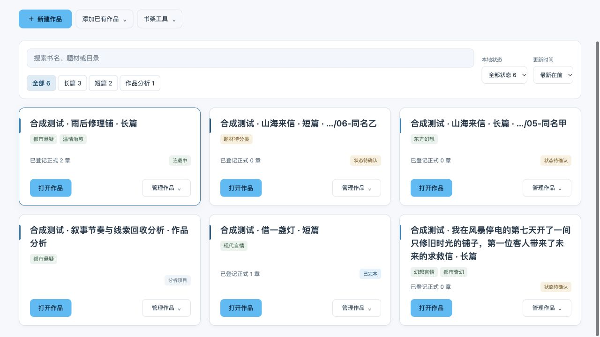
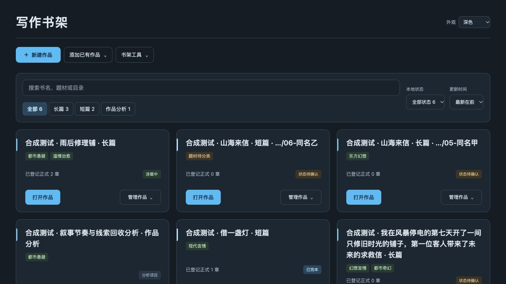
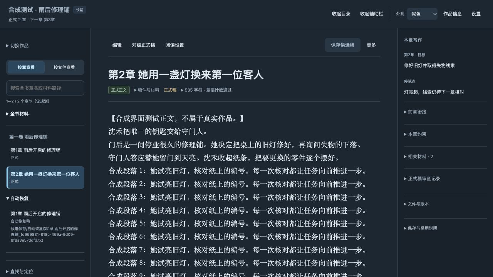

# 工作台界面去冗余验收

日期：2026-10-19。Mac 0.1.11（build 12），Windows 0.1.5，内嵌运行时仍为 0.6.19 候选。生产变更提交：`bcb6966b7e6dc9c07711806cbd26b7d2000199e8`。

## 精简内容

- 书架只保留“写作书架”标题，移除品牌副标题、“我的作品”标题和顶栏重复总数。类型筛选继续显示计数；搜索、状态筛选、无结果或类型待确认时显示结果摘要。
- 刷新及使用说明归入“书架工具”。完整更新时间移至每张卡片的“管理作品”，原时间节点、来源说明和未确认状态保留。卡片高度由 246 缩至 210 像素。
- 编辑页顶栏只留正式章数及下一章，完整规划数和刷新时间保留在“作品信息”与悬停说明。刷新统一放在“设置”；无分页时收起禁用翻页条，定位移入“查找与定位”。
- 保存状态、未保存提醒、稿件身份、异常提示、不可用作品说明、同名作品区分、正式章数和本地状态继续显示。主色保持天空蓝 `#38BDF8`。

## 验证

独立相关回归 109 项全部通过，无跳过。覆盖搜索、筛选、排序、更新时间来源、管理菜单原节点及事件、候选缓冲、主题切换、旧服务外观兼容、原生书架识别和离开保护。编辑专项另已通过 112 项；最后的进度更新修正通过 21 项复验，这些集合有重叠，不相加计数。

浏览器实际核对了唯一书架标题、无重复总数、默认摘要折叠、210 像素卡片、天空蓝计算样式、管理内完整更新时间、搜索无结果提示、工具中的刷新及帮助。编辑页实测只有一个可见刷新入口，完整进度可查看，翻页条隐藏时目录范围和错误节点仍保留；390 像素编辑窗口无横向溢出。

9 个合成正式数据库与章节文件哈希保持一致。合成服务在验收后正常鉴权停止；截图仅含合成作品。

## 本地应用

旧客户端正常退出后，完整备份 0.1.10 应用，逐文件比较并替换为 0.1.11。严格签名、内置 CLI 隔离检查与实际运行版本检查通过。新版独立书架已启用，实际服务输出确认精简结构和天空蓝主色；6 个既有作品服务与书架登记哈希保持不变，未强制结束进程。

旧作品服务继续使用原来的后端代码，Mac 原生外观兼容层装饰其支持的页面。此轮没有迁移或重写真实稿件。

## Windows

Windows 0.1.5 候选的 [Actions 安装构建](https://github.com/NingCui29/story-skill/actions/runs/39236381261)成功。安装、原生窗口、书架识别、明暗主题、合成更新进度、运行时备份恢复和卸载检查通过；原生截图确认重复副标题及大号总数已经移除。下载链接见主 README，脱敏验证结果见 `windows-installer.json`。安装包仍是未签名候选，自动化检查不代表全部 Windows 10/11 使用环境与原生交互的人工验收。
