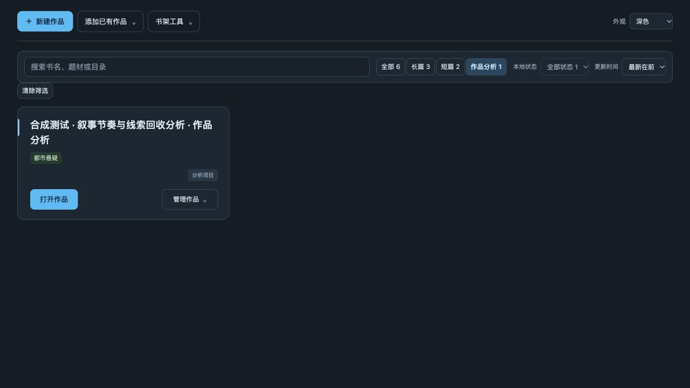
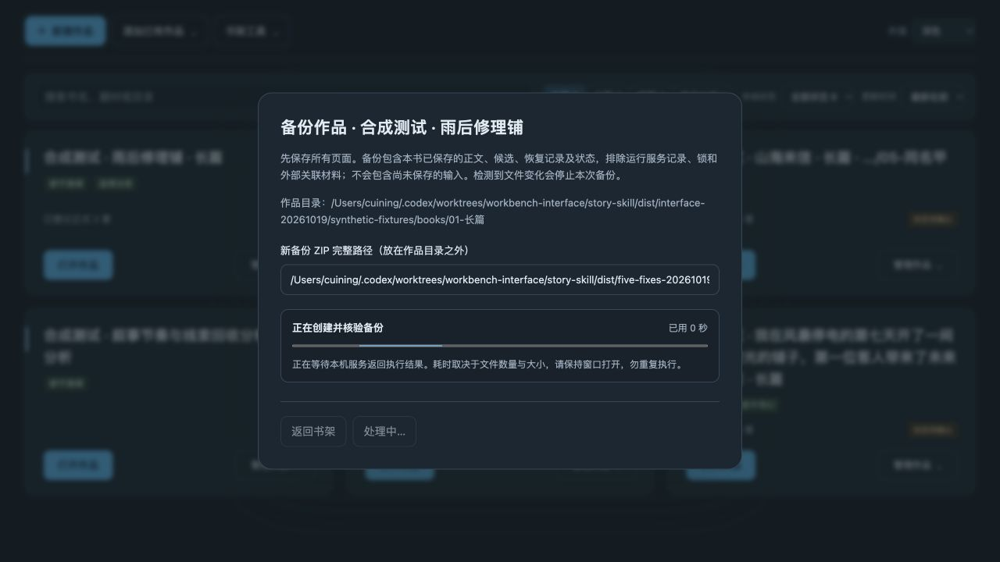
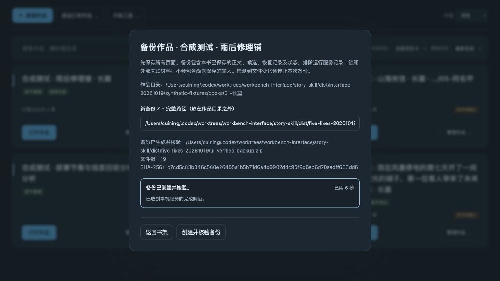

# 工作台五项交互问题修复验收

日期：2026-10-19。Mac 0.1.14（build 15），Windows 0.1.8，内嵌运行时仍为 0.6.19 候选。生产提交：`7f81a4f9929fd91f848678c5cfb5571770f61855`。

## 修复

1. 切到作品分析时重置不适用的连载／完本筛选，明确区分空分类与筛选无匹配，增加清除筛选；原清空搜索仍只清搜索。
2. 书架顶栏及作品管理菜单互斥，外部点击与 Esc 收起；Esc 返回入口焦点，弹窗打开前关闭菜单，保留内部输入和嵌套说明的原节点与事件。
3. 刷新错误使用独立节点记录归属，成功时仅移除自己的旧错误，保留其他操作回执。
4. 返回书架轻量更新，保留搜索、类型、状态和排序。浏览器事件及 Mac／Windows 原生返回信号进入同一合并与节流队列；菜单、弹窗、操作忙、路径输入或卡片状态未保存时延迟，响应返回时再次检查，防止覆盖正在操作的界面。
5. 备份、恢复等操作显示操作名、已用时间和不确定进度条；保留填写内容，忙碌时防止重复及误关闭，完成后恢复控件。未收到响应时明确结果待核对，不把网络错误当成任务没有执行，不自动重试。没有虚构百分比或后端阶段。

## 验证

107 项书架、管理 HTTP、候选接口与新增行为回归，以及 23 项原生返回、Windows关闭安全与Mac页面缓存检查，合计130项全部通过，无跳过。完整AppKit应用已构建成功。

合成界面实测切分析后有1张卡、状态自动回到全部；顶栏菜单互斥、外部点击及 Esc 收起和焦点回归；模态框无残留菜单；模拟一次目录读取失败后，刷新成功时旧错误消失且6张卡恢复。

备份界面通过真实合成备份验证：仅为观察等待状态在隔离服务中增加6秒延迟，实际创建并核验19个文件的ZIP，处理中显示计时和不确定进度，完成后显示校验结果并恢复控件。这不代表备份性能测试。9个既有合成数据库与正式章节文件哈希保持一致，合成服务已正常停止。

返回刷新及竞态保护通过可控制响应顺序的JS行为夹具验证；原生信号用真实提取的Swift方法隔离编译和Windows方法执行验证受控地址边界及缓冲保留，本轮没有用自动化操作实际桌面标签切换。

## 本地安装与启用

完整备份0.1.13并逐文件比较后，已替换为0.1.14。严格签名及内置CLI隔离检查通过。首次启动时macOS重新询问受保护文件夹访问：文稿已允许，下载授权仍在等待；应用与书架进程已启动，服务就绪尚待授权后核对。没有强制结束进程，真实作品编辑服务保持运行。

## Windows 候选

Windows 0.1.8 的[安装构建](https://github.com/NingCui29/story-skill/actions/runs/39248525443)成功，源码与本轮生产提交一致。安装、原生窗口、明暗主题、合成更新进度、内置运行时数据安全及卸载检查通过。下载见主README，脱敏信息见 `windows-installer.json`。安装包尚未签名，Actions附件预计于2027-01-17到期；自动检查不代表全部Windows 10/11用户环境的人工验收。
