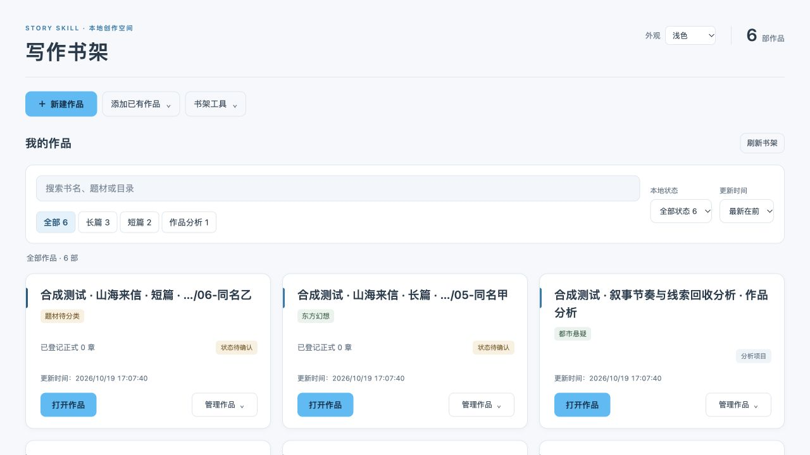
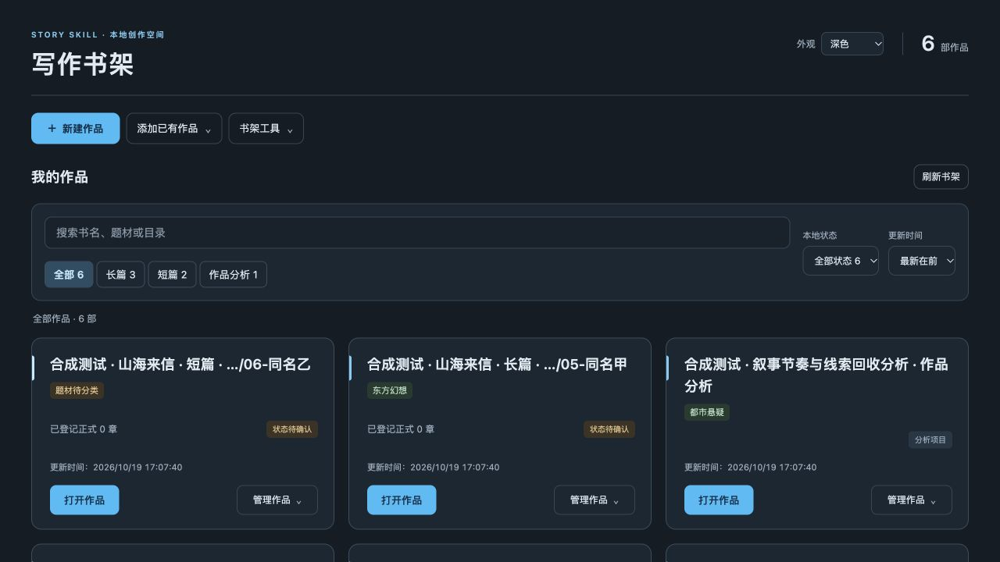

# 工作台天空蓝主题与界面精简验收

日期：2026-10-19。运行时代码仍为 0.6.19 候选，客户端为 Mac 0.1.10 / Windows 0.1.4。生产改动提交为 `a96dad938243ad08db715fdbd5b6a0251d4bc31d`。

## 界面变化

明暗模式的主按钮统一使用天空蓝 `#38BDF8`，文字为 `#082F49`，对比度为 6.478。链接与小字使用更深的蓝色变体以保留可读性。书架集中搜索和筛选；低频恢复功能放入“书架工具”，分类依据、目录及状态设置放入“管理作品”。编辑页将外观入口移至顶栏，稿件与材料默认折叠，候选保存及未保存状态继续直接显示。

原有控件通过移动节点保留事件、值和身份。Mac 兼容外观脚本仅装饰支持的本地页面，不重建正文编辑器或修改稿件缓存；旧编辑服务继续运行。

## 已执行验证

- 工作台与桌面回归共 604 项，0 失败、0 错误，2 项 Windows Shell 条件跳过。Windows 构建机另外执行了回收站相关检查。
- 独立 UI 安全审阅 85 项通过；6 个合成数据库与 3 份正式章节共 9 文件的哈希保持一致。
- 浏览器实测浅色、深色主按钮均为 `rgb(56, 189, 248)`。1280、760、390 像素宽度均无横向溢出；管理菜单末项可随页面滚动到达。
- 合成编辑页中，主题切换前后的未保存文字、选区与滚动位置一致；随后通过原保存入口保存为候选。
- 首次综合检查发现旧原生测试夹具只提供空对象、未模拟真实页面；已修正夹具并保留实际脚本注入及安全断言。首次另有一次服务启动等待未确认；单独 23 项、前序组合 32 项及最终完整回归均通过，未改启动等待逻辑，未确定首次失败原因。

截图均为合成作品，不包含真实书稿：





## 本地安装

Mac 0.1.10 已完整备份旧应用、逐文件核验后替换，严格签名和内置 CLI 隔离检查通过。新客户端与独立书架已启动；实际书架服务和浏览器计算样式均确认天空蓝生效。6 个原有作品服务及书架登记哈希保持不变，未强制结束进程。

本地 DMG 为 `story-workbench-0.1.10-macos-x86_64.dmg`，37,959,551 字节，SHA256：

```text
497ae47f3dab858c776265d4b8af060bddff9d8b79f198a189db11dccf30d361
```

DMG 镜像校验、只读挂载后的签名和关键载荷比较通过。应用采用本地临时签名；未作为正式 Release 附件发布，Apple Silicon 未验证。

## Windows 与剩余限制

[Windows 安装构建 39230308569](https://github.com/NingCui29/story-skill/actions/runs/39230308569) 成功，运行 Python 3.12。安装包、便携包及有效期见主 README。

同一提交的[完整源码 CI 39230308579](https://github.com/NingCui29/story-skill/actions/runs/39230308579) 中，Ubuntu Python 3.10 与 Windows Python 3.12 成功；Windows Python 3.10 共 1937 项检查中有 1 项 `test_bundle_starts_reuses_and_leaves_authenticated_service_running` 失败、58 项跳过。首次启动返回 2 而非 0，现有日志未包含结构化错误原因。该测试及后端启动代码本轮未改，主题与外观检查在该作业中均通过；尚不能将失败归因于界面改动或环境。此记录不表示所有 CI 均通过。

Windows 安装程序未签名，真实 Windows 10/11 使用环境、全部原生交互与手动安装流程仍需验收。截图、DOM 和自动化检查不替代这些验证。
